# DbCodeGen 代码生成器

数据库驱动的智能代码生成桌面工具（.NET 8 WPF，开源）。

把「表元数据 × 模板 × 输出路径」串成一条自动化流水线：**多选表 → 模板包渲染 → dry-run 预览 → 安全写盘**。并内置完整 AI 能力，从零写模板、改模板、把其他生成器的模板迁移过来，全都可以自动完成。

## 核心特性

### 多数据源

- 同时管理 **MySQL / PostgreSQL** 多套连接，密码经 Windows DPAPI 加密保存
- 工具栏一键切换当前连接，数据源管理窗口支持新增 / 编辑 / 测试连接 / 删除
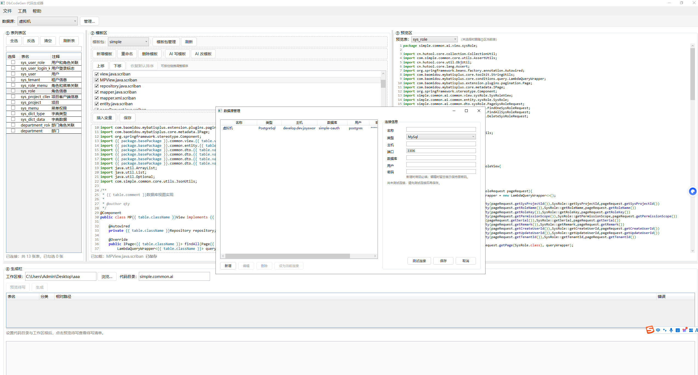
### 多项目、多模板组

- **多项目**：工作区根 + 代码目录双配置，一套工具管理多个项目的代码输出，最近目录自动记忆
- **多模板组（模板包）**：内置模板包与用户模板包并存，zip 导入 / 导出分享；模板包与包内文件均支持拖拽 / 上移下移排序，即时持久化、一键恢复默认
- **勾选到层**：每个模板文件可独立勾选，精确控制参与批量生成的文件集合
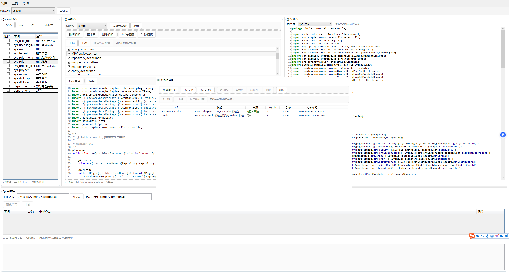
### 模板编辑与实时预览

- 内嵌 AvalonEdit 编辑器，按目标语言自动语法高亮
- 变量面板双击插入 `{{变量}}` 表达式，修改模板即时预览真实渲染结果，渲染错误精确定位到行列
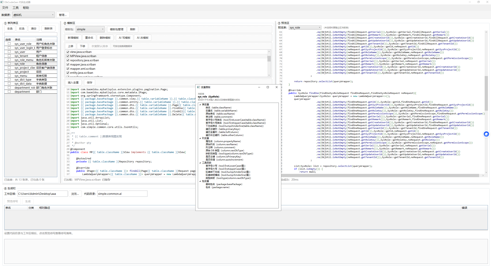
### 批量代码生成

- 多选表 × 模板包 → 渲染 → dry-run 预览（新增 / 覆盖 / 跳过分类）→ 确认后安全写盘
- 支持输出到 `src/main/resources` 等代码根外目录（`../` 越级），生成日志全程记录
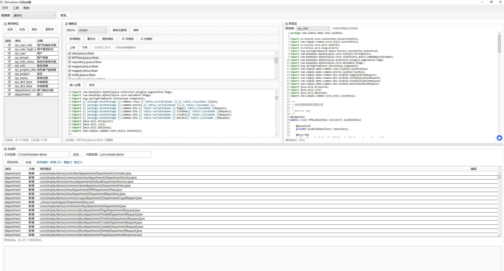
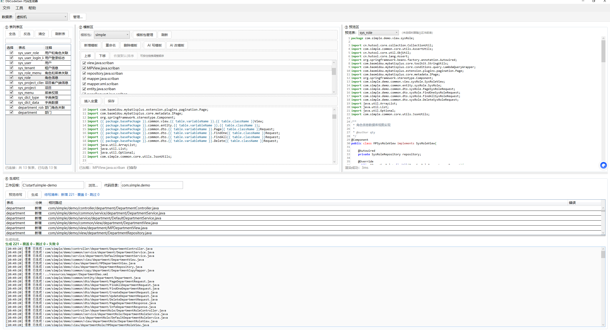
### AI 写模板（全自动）

- 一句话描述技术栈 + 选一个样例表 +（可选）参考文件 → AI 自动生成整套模板包，生成时间会比较久，耐心等待即可
- 生成内容经完整性校验后一键落库，支持新建模板包或追加到现有用户包

### AI 迁移其他生成器模板（零配置）

- 把 EasyCode / 其他生成器的 Velocity、FreeMarker 模板，或现有项目的代码，直接作为参考文件上传
- AI 自动把 Velocity 语法翻译成 Scriban，逐文件镜像文件名与相对结构，输出代码风格、注解、import、包结构保持一致
- **无需任何手工配置**，即可把其他生成器的整套模板迁移到本软件
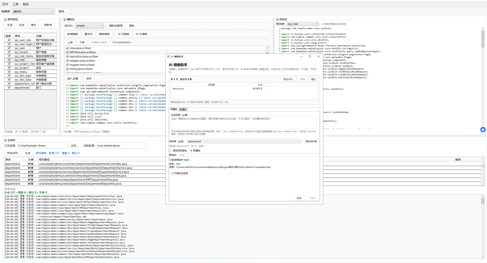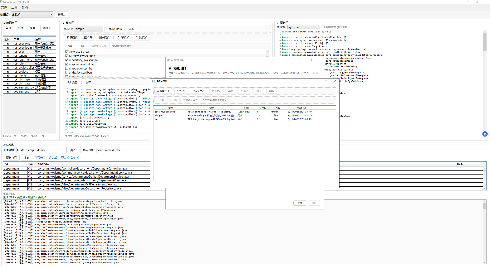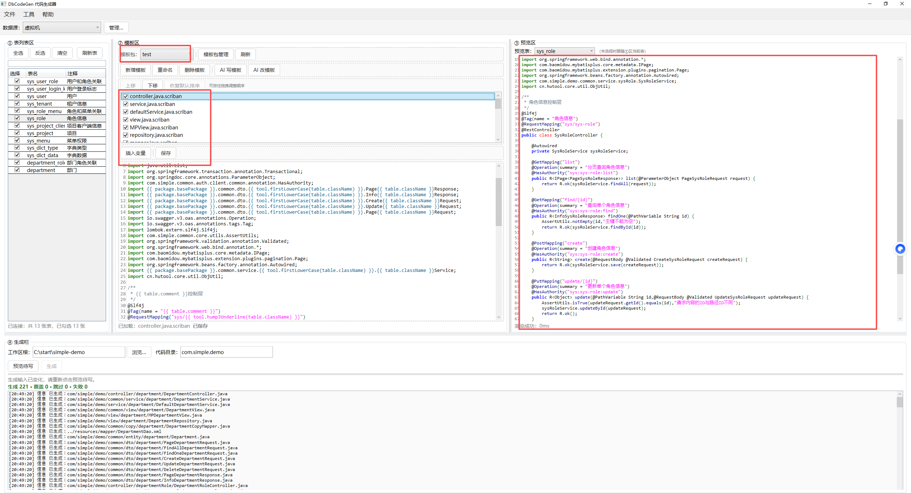

### AI 改模板（对话式）

- 选中模板后直接对话修改，AI 返回完整新文件，一键「应用到编辑器」，继续走预览 / 保存链路
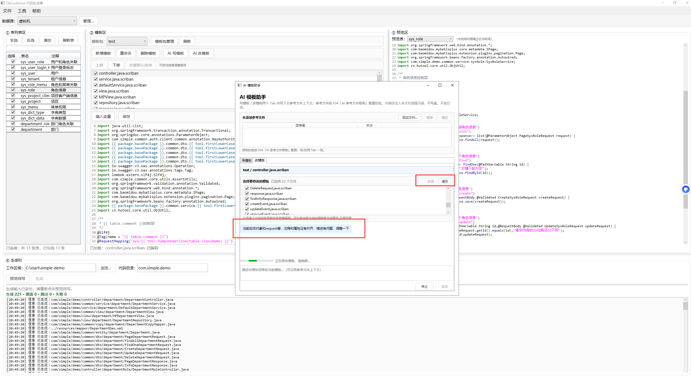

### 类型映射

- 数据库类型 → 目标语言类型全局映射，支持包级 typeMap 覆盖与兜底规则，JSON 导入 / 导出
- 生成前自动预检未映射类型
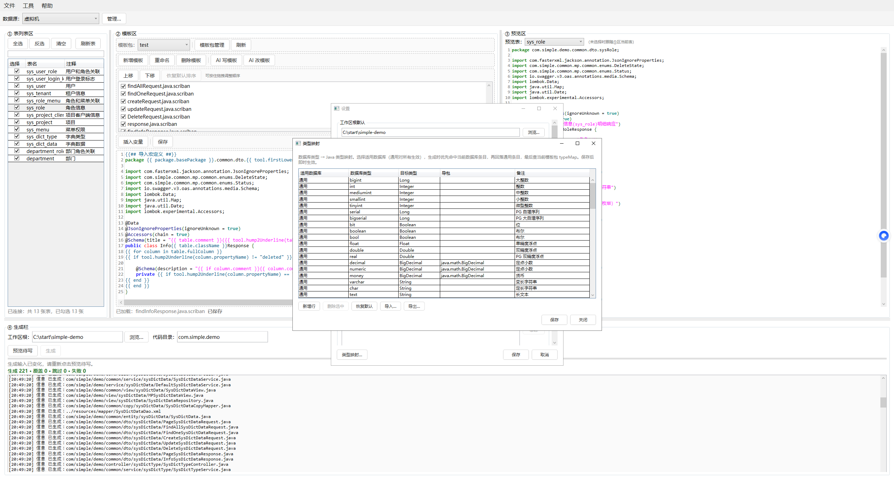
### SQL 执行面板

- 内置 SQL 执行器，支持命令超时与结果行数上限
- 危险语句检测：DROP / TRUNCATE / 无 WHERE 的 DELETE·UPDATE 执行前二次确认
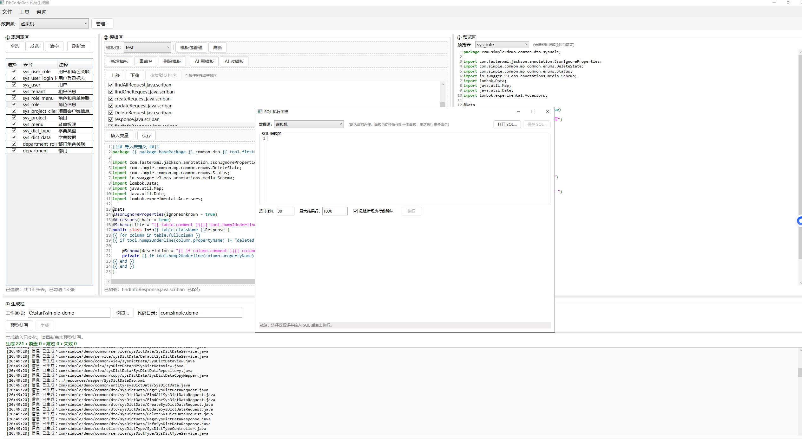
### 备份 / 恢复

- 全部配置一键打包成 `.dbcg` 文件，换电脑迁移零成本

## AI 能力

- 基于 OpenAI 兼容协议直连，默认通义千问（DashScope 兼容端点），兼容 DeepSeek / 智谱 / Kimi / OpenAI 等模型
- API Key 经 Windows DPAPI 加密保存，明文不落盘、不落日志
- 支持测试连接与模型下拉刷新
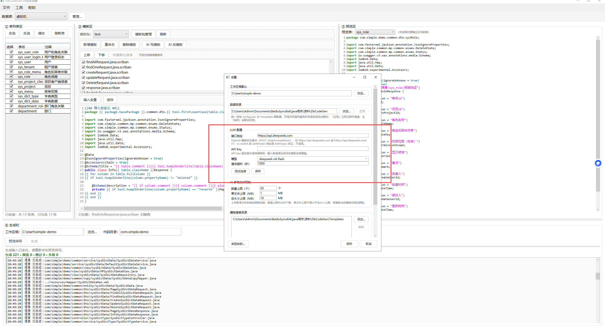
## 快速开始

1. 「工具 → 数据源管理」添加 MySQL / PostgreSQL 连接，或直接在工具栏选择
2. ① 表列表区勾选要生成代码的表
3. ② 模板区选择一个模板包（没有合适的模板？用「AI 写模板」生成一套）
4. ④ 生成栏配置工作区根与代码目录，点「预览待写」核对、点「生成」写盘

## MCP 服务端（接入 AI 客户端）

除桌面客户端外，本工具自带一个**本地 stdio MCP 服务端**（`src/DbCodeGen.McpServer`，.NET 8 控制台程序）。任何支持 MCP stdio 传输的 AI 客户端（Claude Desktop、ZCode、Cursor 等）把它作为子进程拉起后，即可用自然语言驱动全部代码生成能力：查表结构、管数据源、改模板、预览渲染、批量生成。

MCP 服务端本身不做任何 LLM 调用——智能由 MCP 客户端侧的大模型承担，服务端只暴露工具面，并与桌面端共享同一份配置与模板库。

### 工具清单（19 个，tools/list 实测）

| 分类 | 工具 | 说明 |
| --- | --- | --- |
| 只读枚举（8） | `list_template_packages` | 列出全部模板包（内置 + 用户），含说明、只读标记、文件数 |
| | `list_templates` | 列出指定包内模板条目（路径、输出路径模板、启用标记），可按分组 / 语言过滤 |
| | `read_template` | 读取模板文件正文全文（Scriban 源文本） |
| | `list_datasources` | 列出已保存的数据源连接（密码永不回显） |
| | `list_tables` | 列出指定数据源下全部表（表名、类名、注释；不含列） |
| | `get_table_detail` | 读取指定表的完整列元数据（类型、主键、自增、可空、注释等） |
| | `get_type_map` | 查看生效的类型映射表（全局 > 包 typeMap > 兜底） |
| | `check_type_mapping` | 生成前预检未映射的数据库类型 |
| 模板编辑（4） | `save_template_content` | 覆写保存用户包内既有模板正文（内置包只读拒绝） |
| | `create_template_file` | 向用户包新增空模板文件（可含分组目录） |
| | `delete_template_file` | 删除用户包内模板文件（不可恢复） |
| | `rename_template_file` | 重命名 / 移动用户包内模板文件 |
| 渲染预览（2） | `render_template` | 以合成表上下文渲染单个模板，语法错误精确到行列 |
| | `preview_generation` | 批量生成 dry-run 预览（零写盘）：表 × 模板的文件计划与未映射类型清单 |
| 代码生成（1） | `generate` | 执行批量生成并写盘（内部先重算 dry-run；建议先 `preview_generation` 确认） |
| 数据源管理（4） | `add_datasource` | 新增数据源连接（密码 DPAPI 加密入库） |
| | `update_datasource` | 按名更新连接（只传要改的字段） |
| | `delete_datasource` | 按名删除连接 |
| | `test_connection` | 测试连通性（10 秒超时）：传 `datasource` 按已保存连接测试，或传完整明文参数直测（不入库不留痕） |

`generate` 全参数显式、不读写配置记忆：`package`（包名）与 `tables`（内联表结构，列元数据自带，建议先用 `get_table_detail` 取回）必填；`files` 省略时默认选择包内全部启用条目；`workspaceRoot` / `codeDirectory` 指定输出位置；`duplicateStrategy` 控制同名文件覆盖（`overwrite`）或跳过（`skip`）。

### 构建发布

```powershell
dotnet publish src/DbCodeGen.McpServer -c Release
```

产物输出到 `src\DbCodeGen.McpServer\bin\Release\net8.0-windows\publish\`，入口为 `DbCodeGen.McpServer.exe`，内置模板包 `Templates\Builtin\` 随发布一并复制。

整包打包用仓库根脚本 `.\package.ps1`：桌面端输出到 `out\DbCodeGen\`，MCP 服务端输出到其子目录 `out\DbCodeGen\McpServer\`。缺省为框架依赖模式（目标机需已装 .NET 8 运行时），传 `-SelfContained` 后两者均自包含、目标机免装运行时。

### AI 客户端注册（stdio）

MCP 服务端以 stdio 子进程方式被 AI 客户端拉起，注册时提供 exe 全路径即可，无需参数。以上述发布产物为例，可执行命令为（占位路径，替换为实际全路径）：

```
C:\path\to\DbCodeGen.McpServer.exe
```

通用 MCP 客户端配置 JSON 片段（`command` 填实际 exe 全路径）：

```json
{
  "mcpServers": {
    "dbcodegen": {
      "command": "C:\\path\\to\\DbCodeGen.McpServer.exe",
      "args": []
    }
  }
}
```

### 运行约束与双开注意事项

- **同机同用户**：数据源密码与 AI Key 均以 Windows DPAPI（CurrentUser 作用域）加密保存，仅同机同 Windows 用户可解密；stdio 子进程形态天然同机，不提供远程形态。换机 / 换用户复制配置无法解密，需重新录入。
- **与桌面端共享数据**：与桌面端共用同一份 `%AppData%\DbCodeGen\config.json` 与用户模板库（若桌面端已通过 `config-location.json` 重定向数据目录，则共用重定向后的目录）。config 读写与模板包操作均经跨进程命名 Mutex 串行化，双开不会互相写坏文件。
- **模板变更感知**：桌面端不监听模板文件变更（无 FileSystemWatcher）。模板内容被 MCP 修改后，桌面端需重新加载包（重新打开「模板包管理」窗口，或重启应用）才能看到最新内容。
- **内置模板包只读**：内置包 `java-mybatis-plus` 只读，MCP 编辑类工具对内置包一律拒绝；生成用模板请复制到用户包或使用既有用户包。
- **日志**：MCP 服务端日志固定落 `C:\simple\DbCodeGen.McpServer\logs\`（按天滚动、保留 7 天、单文件 20MB 上限，多实例共享写）。

> **工具使用手册**：19 个工具的完整参数表、返回字段、错误契约与推荐调用顺序（首次接入/数据源接入/生成主流水线/模板维护/连接直测五条管线）见 [docs/db-codegen-MCP工具使用手册.md](docs/db-codegen-MCP工具使用手册.md)。
